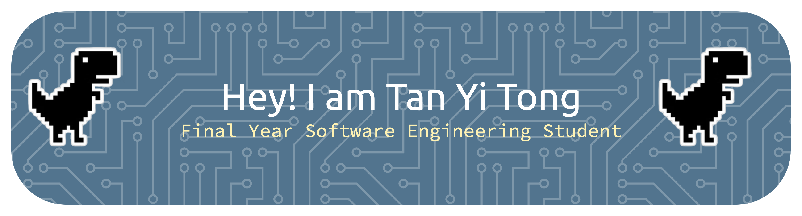

# 👋 Hello, I'm Tan Yi Tong!

I’m a Software Engineering student at Universiti Malaya who enjoys building software and learning how different technologies work together. I’m particularly interested in application development and artificial intelligence, and I enjoy turning ideas into practical projects.

One thing I find interesting about software is that development does not simply end when an application is completed. Software needs to continue changing as users, technologies, and requirements change.

## 🔍 What I Hope to Gain

Through Software Maintenance and Evolution, I hope to understand more about the work involved in keeping software useful after its initial development.

I would like to learn how developers:

- 🔧 Improve existing software without unnecessarily breaking its functionality
- 🐛 Deal with bugs and unexpected issues in real systems
- 🔄 Adapt software when requirements and technologies change
- 🧩 Understand and work with code written by others
- 📈 Make software easier to maintain in the long term

I hope this course gives me a better perspective on software beyond just building new features, and helps me become a developer who can contribute to software throughout its lifecycle.

## 🛠️ Technical Skills

### 💻 Languages

### 🎨 Frameworks & Libraries

### 🗄️ Databases & Cloud

### 🧪 Testing & Tools

## 🌱 Outside of Coding

I enjoy **exploring cafés, baking, and learning Korean**. ☕🥐🇰🇷

